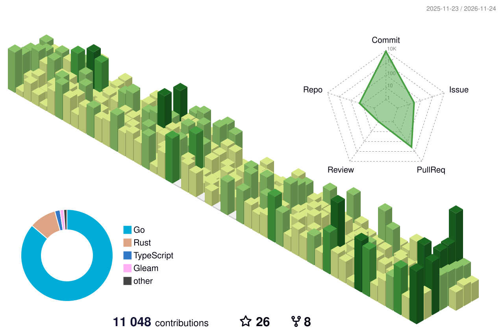

### Hi, I'm Kaikei 👋

I'm a software engineer in Tokyo. I build developer infrastructure in Rust and Go: a reverse proxy extended with WebAssembly, a checker for architecture decision records, and a small data format for declaring desired state. My projects run on top of each other, so most of them get used every day.

**New here? Start with [DocDag](https://github.com/Kaikei-e/DocDag).** It treats your ADRs as a graph and fails CI when they contradict each other.

#### Projects

| Project | What it is | Stack | Status |
| :-- | :-- | :-- | :-- |
| [DocDag](https://github.com/Kaikei-e/DocDag) | Checks decision records (ADRs) the way a compiler checks code. It catches superseded records still marked `accepted`, dangling or circular `supersedes` links, and silent edits to accepted records, and tells you (or your coding agent) which decisions are in force. | Go | v0.7, ready to use |
| [PlectoProxy](https://github.com/Kaikei-e/PlectoProxy) | A self-hostable L7 reverse proxy and API gateway. Rust handles the fast path; request logic runs as sandboxed WebAssembly Component Model filters that you can write in any language and hot-swap without downtime. | Rust, Wasm | Early development |
| [LKAL](https://github.com/Kaikei-e/LKAL) | A minimal data format for declaring desired state. A value's type is decided by its syntax alone. | Go | Draft spec (v0.2) |
| [kisage](https://github.com/Kaikei-e/kisage) | A deterministic reconciler for LKAL documents, with Lean 4 proofs of its core safety properties. | Go, Lean 4 | Reference implementation |

#### Also building

- [Alt](https://github.com/Kaikei-e/Alt): a self-hosted RSS reader that turns what I read into searchable, summarized knowledge, using models that run on my own machine. It is my daily driver and the testbed for the projects above: PlectoProxy sits at its edge, and DocDag checks its 900+ ADRs.
- [MatrixWhale](https://github.com/Kaikei-e/MatrixWhale): live weather alerts, earthquakes and natural hazards (NOAA, USGS, EMSC, GDACS, and national alerting authorities in about 130 countries) on a nautical-chart globe.
- [Modal One](https://github.com/Kaikei-e/modal-one): an experimental WebAssembly-only kernel for x86_64, written by hand in Rust. A slow, long-term learning project; design documents only so far.

#### Interests

WebAssembly Component Model and WASI · performance engineering and benchmark methodology · architecture decision records · distributed systems

#### Writing

- [Zenn](https://zenn.dev/e_kaikei): technical articles, mostly in Japanese
- [Blog](https://the3ridge.me): notes, essays and photography

#### Contact

Questions or feedback about a project? Please open an issue in its repository.

 
<picture>
  <source media="(prefers-color-scheme: dark)" srcset="./profile/contrib-3d-dark.svg">
  
</picture>

